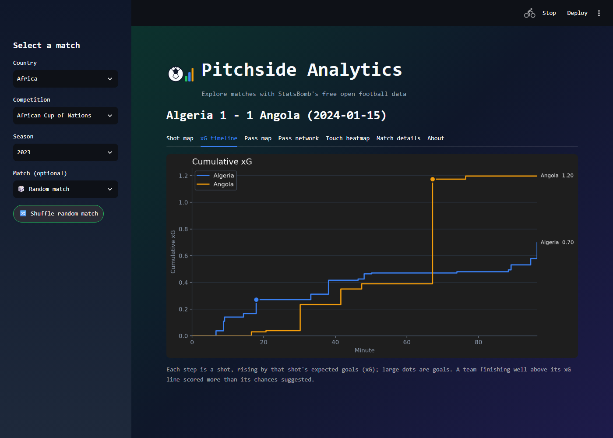
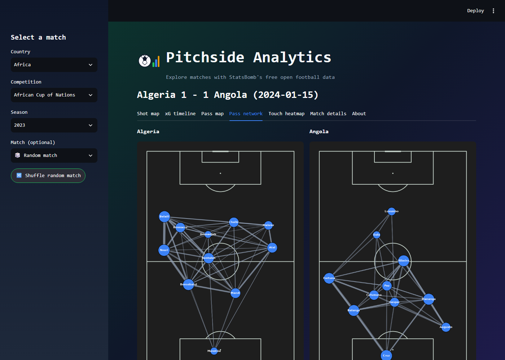
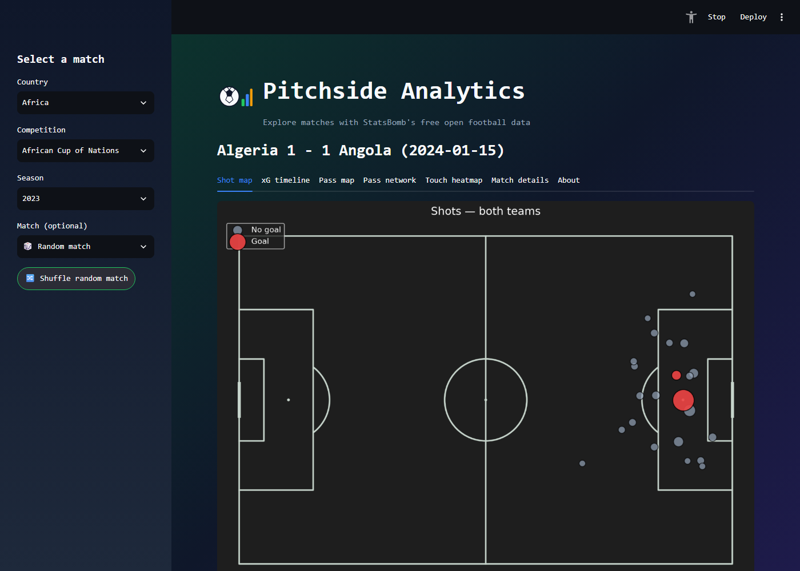

# Pitchside Analytics

[](https://github.com/natraj-kavirayani/pitchside-analytics/actions/workflows/tests.yml)

A Streamlit app for exploring football matches through StatsBomb's free
open event data: shot maps, an xG timeline, pass maps, pass networks,
touch heatmaps, and match details (starting XIs, managers, substitutions).
Built with `statsbombpy` for data access and `mplsoccer` for pitch plotting.



| Pass network | Shot map |
| --- | --- |
|  |  |

## What it shows

- **xG timeline**: each team's cumulative expected goals, shot by shot,
  with goals marked. It shows at a glance whether a result was deserved.
  In the Algeria 1-1 Angola match above, Angola's single big chance
  (0.8 xG) outweighed all of Algeria's shots combined.
- **Pass network**: each player at their average on-the-ball position,
  sized by passes made, linked to the teammates they combined with most.
  Only passes before the team's first substitution are used, so the
  shape reflects one settled XI.
- **Shot map, pass map, touch heatmap**: where the shots, passes and
  touches happened.
- **Match details**: starting XIs with positions, managers and a
  substitution timeline.
- **Match overview**: each team's xG, shots, shots on target, passes and
  pass completion side by side. It shows above the tabs when you pick a
  match. **Minimize** (or opening another tab) shrinks it smoothly into a
  pill-shaped **Match overview** button while the tabs and chart move up
  into the space; the pill grows it back.

**About** at the bottom of the sidebar opens a separate page about the
project (also at `/about`); "Back to matches" returns to the same match
and tab.

Tabs slide in when you switch between them, and the header, summary bars
and charts animate in. All motion is off for viewers whose device is set
to reduce motion, and can be switched off with **Reduce motion** in the
sidebar.

## Run it locally

```bash
pip install -r requirements.txt
streamlit run app.py
```

In the sidebar, pick a Country, Competition and Season, then either choose
a match or leave it on "Random match" and use Shuffle. Only the
competitions in StatsBomb's open data are available (e.g. several World
Cups, AFCON 2023, FA WSL, Messi's La Liga seasons).

To run with no network access, on a small made-up sample league:

```bash
PITCHSIDE_DATA_SOURCE=sample streamlit run app.py
```

## Architecture

```text
app.py                  entry point: builds the service, runs the page
pitchside/
  data/                 where match data comes from
    source.py           MatchDataSource protocol; StatsBomb, in-memory and caching sources
    sample.py           deterministic offline sample league
    schema.py           the columns the app relies on (the data contract)
  analytics/            pure functions: frames in, frames out, no I/O
    shots.py            shots, xG timeline, penalty shootouts
    passing.py          passes, pass networks
    lineups.py          starting XIs, substitutions, managers
    summary.py          per-team headline numbers
  service.py            MatchService: a data source + the analytics
  viz/                  matplotlib charts and HTML tables (no Streamlit)
  ui/                   the Streamlit front end
    app.py              run(service): the match page and the About page
    views.py            the tabs, as a registry (label, accent colour, renderer)
    about.py            the About page
    overview.py         the match overview and when it is shown
    sidebar.py          match picker and display settings
    theme.py            static styling: colours, fonts, logo
    motion.py           animations and transitions, declared as data
```

Each layer only depends on the ones listed above it. The app receives
its `MatchService` as an argument, so the same app runs on live data, on
the sample league, or on a test's in-memory frames, with nothing patched.
Tabs are lazy: only the open tab's view runs on each interaction.

Adding a tab means adding one `View` to `pitchside/ui/views.py`; the tab
bar, its colour and the tests that cover every tab all read that list.

## Testing

The test strategy (what can go wrong, why each layer exists, what is
deliberately not tested, and how AI was used) is in [TESTING.md](TESTING.md).

```bash
pip install -r requirements.lock
pytest                    # every offline layer (no network, no server)
pytest --cov              # same, with coverage of the pitchside package
pytest -m live            # data contract checks against live StatsBomb data
pytest -m e2e             # browser tests; needs both servers below
```

The e2e tests need two servers: the live app on port 8501 for the user
journeys, and the sample league on port 8502 for the smoke and motion
tests:

```bash
streamlit run app.py
PITCHSIDE_DATA_SOURCE=sample streamlit run app.py --server.port 8502
```

Before running them, run `playwright install chromium` once and restart
any server already running, so the tests check the current code. Locally
they are skipped with a clear reason when a server is not reachable.

GitHub Actions runs on every push and pull request: first every offline
layer, then, if those pass, a second job that starts both servers, waits
for their health checks and runs the e2e and live tests. In CI a missing
server fails the job instead of skipping, and failed e2e tests upload
screenshots, Playwright traces and the app logs as a build artifact.

| Folder | Marker | What it covers |
| --- | --- | --- |
| `tests/unit/` | `unit` | Each module alone: analytics (including property-based tests with Hypothesis), data sources, charts, tables, theme, motion rules. |
| `tests/integration/` | `integration` | `MatchService` on real sources: the layers agree with each other, caching works through the stack. |
| `tests/contract/` | `contract` | The sample league, and (with `-m live`) StatsBomb's live data, against the column contract in `pitchside/data/schema.py`. |
| `tests/component/` | `component` | The whole page via Streamlit's `AppTest`, with the service injected. |
| `tests/e2e/` | `e2e` | Playwright in a real browser: smoke tests and motion tests on the sample league, user journeys through the 2022 World Cup final on live data. |

## Deploying

The app runs as-is on [Streamlit Community Cloud](https://streamlit.io/cloud):
create an app from this repository with `app.py` as the entry point. The
open data needs no credentials.

## Notes

- `app.py` creates one `MatchService` per server process
  (`st.cache_resource`), so every session shares one in-memory cache of
  StatsBomb responses (32 matches at most).
- The font is Aptos Mono, which only renders for viewers who have it
  installed; everyone else gets a fallback monospace font.
- StatsBomb's open data covers selected competitions only. See their
  [open-data repo](https://github.com/statsbomb/open-data) for the list.
